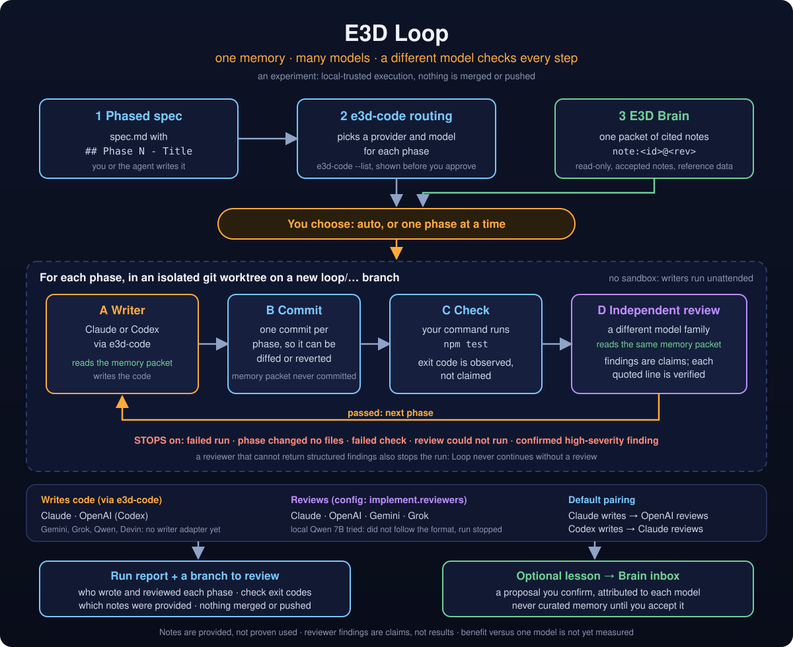

# E3D Loop

> **This is an experiment.** Loop explores one idea: several AI models can work on the same codebase from one **shared, cited memory**, while a **different model checks each step**. It plugs the E3D ecosystem into a real terminal coding agent: [Pi](https://github.com/earendil-works/pi) for the agent, **E3D Brain** for memory, **e3d-code** for phased code writing, **E3D Pilot** for multi-model councils. It is alpha software, built to learn what works, not a finished product. Read [Status](#status) before relying on it.

Loop is **not a fork of Pi**. It is a Pi package (one extension, one skill) plus a thin launcher. You get the full, unmodified Pi experience (pinned to 1.5.0), and Loop adds the E3D parts on top. If E3D services are unavailable, Pi still works as a normal single-model agent.

<p align="center"></p>

Docs: [spec](docs/e3d-loop-spec.md) (the roadmap, far larger than what is built) · [architecture](docs/architecture.md) · [first live demo](docs/demo-2026-11-08.md) · [first interactive `loop_implement` run](docs/demo-2026-11-18.md).

## The vision

Today each model session starts cold, and every vendor's agent is its own island. Loop is built around four principles:

1. **One memory, many models.** Memory lives outside any one model, in [E3D Brain](https://github.com/spacepacket1/e3d-brain): plain notes, searchable by any model, each result pinned to an exact revision (`note:<id>@<rev>`). Whichever model writes or reviews, it reads the same cited notes. Memory is advisory: it is handed over as labelled reference data, never as instructions.
2. **Independent checking.** The model that writes code is not the model that reviews it. A reviewer from a different family looks at each step, and Loop checks that every quote the reviewer cites really exists in the code. Findings are labelled as claims, not results. A vote between models never replaces a failing test.
3. **Small steps, hard stops.** Work runs one phase at a time. Each phase is committed, checked with your command, and reviewed before the next one starts. Any failure stops the run. Nothing is merged or pushed.
4. **Say what is proven.** Loop records which model did what, and separates what it observed (exit codes, commits) from what a model claimed. More models are not automatically better, so the open question is when they are, measured against one model working alone. That comparison has not been done.

## What works today

| Capability | What it does | State |
|---|---|---|
| Pi agent | Full terminal agent (TUI, tools, sessions, branching, skills, MCP client), pinned and unmodified | Working |
| **`loop_implement`** | Runs a phased spec through [e3d-code](https://github.com/spacepacket1/e3d-code) one phase at a time in an isolated git worktree, with a check and a cross-family review per phase | Working; tested live on small tasks |
| **Shared Brain memory** | Retrieves cited notes from Brain (read-only) and gives the same packet to every writer and reviewer in a run | Working; plumbing verified, benefit not measured |
| **Brain inbox lessons** | Optionally proposes a lesson to Brain's review inbox, attributed to the models that wrote and reviewed | Working; always a proposal, never curated memory |
| **Six model families** | Claude, OpenAI, Gemini, Grok, local Qwen, Devin: see [Models](#models) | Four answer through Pi; Qwen needs a shim; Devin detected only |
| `loop_investigate` | A separate read-only helper session on a snapshot of your repo, optionally a different model, returning evidence-checked findings | Working |
| E3D Pilot | Multi-model debate with recorded dissent, through Pi's MCP client | Connected; a hosted debate ran; pipeline tools not exercised |
| e3d-corp, e3d-creative | Business and creative workflows | Not integrated |

## How a `loop_implement` run flows

```
spec.md (phases)
   │  e3d-code --list: which provider/model for each phase
   │  Brain search → one cited memory packet (read-only, reference data)
   ▼
you choose: auto, or one phase at a time
   ▼
isolated git worktree on a new loop/... branch
   for each phase:
     writer (Claude or Codex, via e3d-code) reads the memory packet and writes code
     Loop commits the phase
     your check command runs                         → stop on failure
     a different model family reviews the diff       → stop on a confirmed high-severity finding
   ▼
report: which model wrote and reviewed each phase, check exit codes, which notes were provided
optional: propose a lesson to the Brain inbox (you confirm)
```

## Models

| Family | Reached through | Writes code (e3d-code) | Reviews |
|---|---|---|---|
| Claude | Pi (`anthropic/…`), `claude` CLI | Yes | Yes |
| OpenAI | Pi (`openai/…`), `codex` CLI | Yes | Yes |
| Gemini | Pi (`google/…`) | No (no e3d-code adapter yet) | Yes |
| Grok | Pi (`xai/…`) | No | Yes |
| Qwen (local) | Pi custom provider via `bin/sse-shim.mjs` | No | Poor: a 7B 4-bit model did not follow the findings format in testing, and Loop correctly refused its output |
| Devin | `devin` CLI | Not wired | Not wired |

`e3d doctor` reports which are available on your machine. Only Claude and OpenAI can write code today, because e3d-code drives the `claude` and `codex` CLIs; more writers need adapters in the e3d-code repo.

## Status

Verified: the launcher is transparent versus bare Pi (offline tests); snapshot and confinement logic; evidence checking; the bounds and recursion guard; 27 offline tests; and live `loop_implement` runs where Claude and Codex wrote phases, other models reviewed them, and the same Brain note reached every writer and reviewer.

Not verified or not built:

- **No isolation.** Execution is **local-trusted**: tools run as you on your machine. Pi has no sandbox, and Loop's checks are hooks, not an OS boundary. e3d-code runs its writers unattended, and they can read your disk. A separate worktree is not a sandbox. Do not point Loop at untrusted repositories.
- **Benefit unproven.** A few small runs show the plumbing works. They do not show that shared memory or a second model improves results. In one control run a writer found the same facts on disk without Brain.
- **"Provided" is not "used".** Loop records which notes each model was given. It cannot tell which a model used, so it does not call Brain's `report_use`.
- **Pilot pipeline handoff** (propose/approve/implement), plan-token handling, and Pilot's honoring of Loop's recursion guard are untested.
- **RPC and SDK parity** with Pi is not tested; the launcher passes flags through.
- **Costs are real.** Helper and reviewer calls, e3d-code writers and Pilot debates spend model credits. Cost is Pi's catalog estimate unless the provider reports billed cost.

## Quick start

Requires Node 22.19 or newer, and for `loop_implement` the [e3d-code](https://github.com/spacepacket1/e3d-code) runner on your `PATH` with the `claude` and/or `codex` CLIs installed.

```sh
git clone git@github.com:spacepacket1/e3d-loop.git && cd e3d-loop
npm install
npm link                     # optional: provides the `e3d` command (else: node bin/e3d.mjs)
e3d doctor --connect         # Pi pin, MCP servers, the six model families, e3d-code, command conflicts
```

Give Pi a model credential one of two ways: run `e3d` and type `/login`, or export a provider key in your environment as [Pi documents](https://github.com/earendil-works/pi/blob/main/packages/coding-agent/docs/providers.md). To load keys from files at launch instead of your shell profile, copy [config/run.example.sh](config/run.example.sh), edit the paths, keep it outside the repo, and `chmod 700` it. Never commit keys.

Then run `e3d` in a git repo. It behaves like `pi`: all flags, `-p`, `--mode rpc`, `-c`, `-r`, `mcp`, `install` pass through.

**Try `loop_implement`.** In a throwaway git repo, write a spec with `## Phase 1 - Title` headings, start `e3d`, and ask: *"Use loop_implement on spec.md with action plan"*, then *"run it, with check_command 'npm test'"*. You are asked whether to run **auto** or **one phase at a time**. The code lands on a new `loop/...` branch in a worktree under `~/.local/state/e3d-loop/worktrees/`; your working tree is untouched.

## Configure

Nothing here contains secrets.

**Models.** Pi picks the first available model unless told otherwise. Per launch: `e3d --model anthropic/claude-sonnet-5-5` (add `:high` for thinking level). In a session: `/model`. As a default, in `~/.pi/agent/settings.json`:
```json
{ "defaultProvider": "anthropic", "defaultModel": "claude-sonnet-5-5" }
```

**Pilot and Brain.** Copy entries from [config/mcp.example.json](config/mcp.example.json) into `~/.pi/agent/mcp.json`, or use `pi mcp add`. After editing while a session is open, run `/reload`. `/mcp` shows connection state and handles sign-in (`/mcp login <server>`). Loop's own Brain access (for shared memory) reads the same `futco-brain`-style entry and starts its own Brain process. Local and hosted Pilot both expose `e3d_debate`; tools appear as `mcp__<server>__<tool>`, so name the server you want. The hosted server spends your Pilot credits; ask for a quote first.

**Loop config.** Copy [config/e3d-loop.example.json](config/e3d-loop.example.json) to `~/.config/e3d-loop/config.json` (override the path with `E3D_LOOP_CONFIG`).
- `helper.model`: the model for `loop_investigate`. Use a *different* provider than your foreground model; if unset the helper reuses the foreground model and every report says it is **not independent**. Bounds: `timeoutSec`, `maxTurns`, `maxCostUsd`, `maxTokens`, snapshot limits.
- `implement.reviewers`: which model reviews each writer family, for example `{ "claude": "openai/gpt-5.5", "openai": "anthropic/claude-sonnet-5-5" }`. Defaults are cross-family. Also `e3dCodeBin`, `phaseTimeoutSec`, `checkTimeoutSec`.
- `allowWebSearch` defaults to false.

**Local Qwen.** Run `node bin/sse-shim.mjs` (the local server ignores streaming; the shim re-emits its reply as a stream), then add the `qwen-local` provider from [config/models.example.json](config/models.example.json) to `~/.pi/agent/models.json`.

**Quieter UI.** Pi's `Ctrl+O` collapses tool output and `"hideThinkingBlock": true` in settings hides thinking.

## `loop_implement` in detail

`action=plan` shows the provider and model e3d-code picks for each phase (`--list`, with `--auto-route`) and the Brain notes that would be shared. `action=run` asks you to choose auto or step, then for each phase: runs `e3d-code <spec> <N>` in the worktree, commits, runs `check_command`, and has a reviewer from a different family review the diff. It stops on a failed run, a phase that changes no files, a failed check, an unavailable review, or a confirmed high-severity finding. A reviewer that cannot return structured findings stops the run; Loop does not continue without a review. It never merges or pushes. Non-interactive use needs `E3D_LOOP_ALLOW_UNATTENDED=1`.

**Shared memory.** Unless `use_brain` is false, Loop searches Brain with the spec and phase titles (or `brain_query`, or exact `brain_paths`), keeps only accepted notes, and writes a labelled packet to `.loop-context/brain.md` (never committed). Writers are told to read it through e3d-code's `--read`; reviewers get the same text in their prompt. The run record lists the citations each phase was given. If Brain is down, the run continues and says so.

**Lessons.** `capture_lesson` proposes one note to Brain's **review inbox** after the run (you confirm in the UI; non-interactive use needs `E3D_LOOP_ALLOW_BRAIN_CAPTURE=1`). It records which model wrote and reviewed each phase, exit codes, commits and the notes provided, and is marked as a proposal and a single data point.

## `loop_investigate` in detail

Ask for an independent look ("get an independent review of `src/foo.ts`") and the foreground model calls `loop_investigate`. Loop then:

1. Copies your working tree, including uncommitted edits, to a temporary snapshot. Symlinks, `.env*`, key files and oversized files are skipped.
2. Starts a separate Pi session on that snapshot with only `read`, `grep`, `find`, `ls`. No shell, no edits, no MCP, no Pilot, so it cannot recurse. Tool paths outside the snapshot, including `~`, are blocked by a policy hook.
3. Bounds it by time, turns (with a wrap-up request before the cap), cost and tokens.
4. Returns findings as **claims**. Loop checks that each quoted piece of evidence exists at the cited file and line. That proves the quote is real, not that the claim is right.
5. Records the actual provider and model, the snapshot digest, usage, and a JSON artifact under `~/.local/state/e3d-loop/`.

The foreground prompt also tells the model when to search Brain, when to consult Pilot, and to report only test results it actually ran.

## Roadmap

Not built, from the [spec](docs/e3d-loop-spec.md): an isolated execution profile, verification receipts, parallel helpers, Pilot pipeline handoff, e3d-code adapters for more writers (Gemini, Grok, Qwen, Devin), and the measured comparison against a single model. The next question worth answering is whether shared memory and independent review beat one model working alone.

## Known gotchas

- `e3d -p` waits forever if stdin stays open (for example under a script or CI). Use `e3d -p "..." </dev/null`.
- Pi expands `~` inside its file tools. Loop's confinement rejects it; anything you add must too.
- Pi's extension packages must list Pi as a peer dependency; this repo does, with an exact dev pin for testing.
- Upgrading Pi is a deliberate act: bump the pin, run `npm test` and `e3d doctor`.
- A writer's own verification (inside e3d-code) can fail on tools missing from your machine (for example `tsc`); write specs that do not require them.

## Layout and tests

```
bin/e3d.mjs            launcher: runs pinned Pi with this package; `e3d doctor`
bin/sse-shim.mjs       streaming shim for the local Qwen server
extensions/e3d-loop.ts Pi extension: loop_implement, loop_investigate, /e3d-doctor, guidance
skills/e3d-loop/       when to use Brain, Pilot and the helper
src/                   implement (phased runs), brain (shared memory), mcp-client, providers,
                       helper, snapshot, evidence, doctor, config
config/                example MCP, models, Loop and launcher config (no secrets)
docs/                  spec, architecture, demo record, images/ (README infographic)
tests/                 offline: launcher-vs-Pi compatibility, safety logic, phased runs, Brain
```

`npm test` runs offline with no model calls (27 tests).

## Credits and license

MIT, FutCo LLC. Built on Pi by Earendil Works (MIT). Pilot, Brain and e3d-code are separate E3D projects; improvements to them belong in their own repositories.
